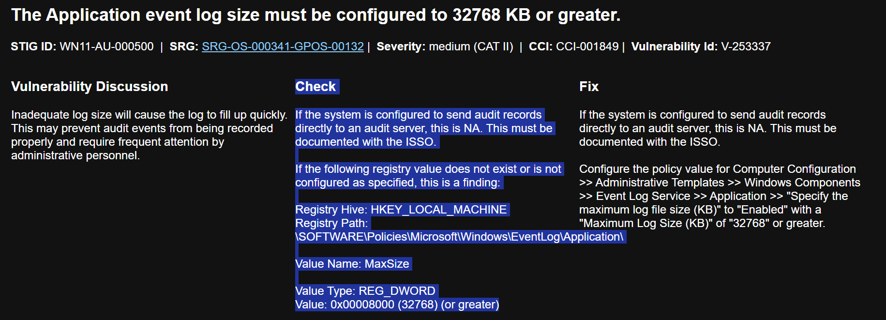
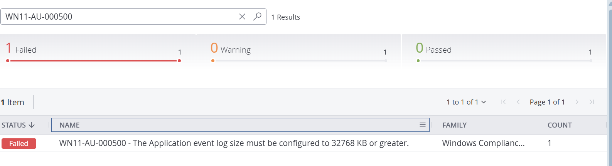
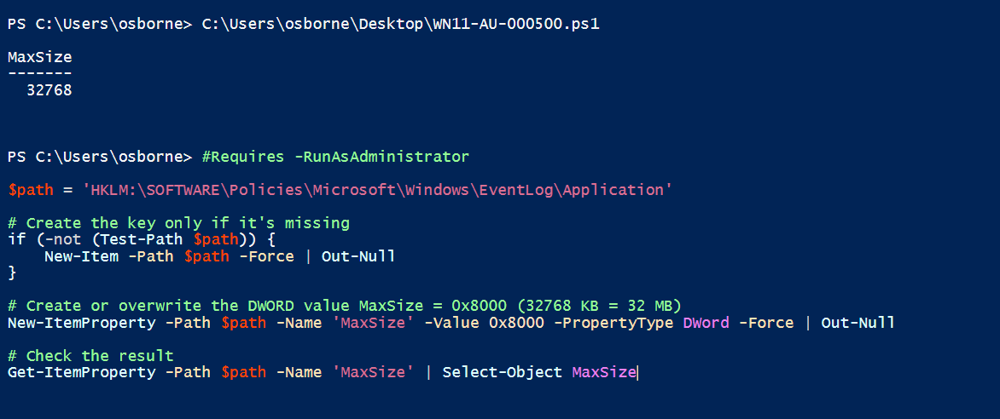
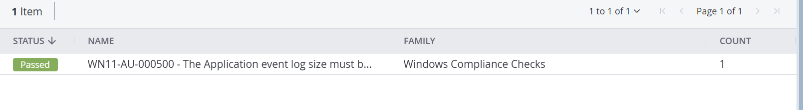

STIG #1: WN11-AU-000500
Rule: The Application event log must be at least 32,768 KB.
Severity: Medium (CAT II) 

What it means: Windows logs app activity. If the log is too small, old entries get overwritten, and attackers can erase their tracks. 

Before: Tenable credentialed scan (DISA STIG audit, Windows 11) → Failed

Remediation:
Opened Registry Editor on the VM
Went to HKLM\SOFTWARE\Policies\Microsoft\Windows\EventLog\
Created the key Application (it didn’t exist)
Created a DWORD value MaxSize = 32768 (decimal)
Restarted the VM

After: rescanned with the same scan → Passed ✅

Undo: deleted the MaxSize value → rescanned → Failed

PowerShell Remediation: ran WN11-AU-000500.ps1 as Administrator 

After: rescanned with the same scan → Passed ✅

Takeaway: a bigger log means evidence sticks around long enough for analysts to investigate. 

