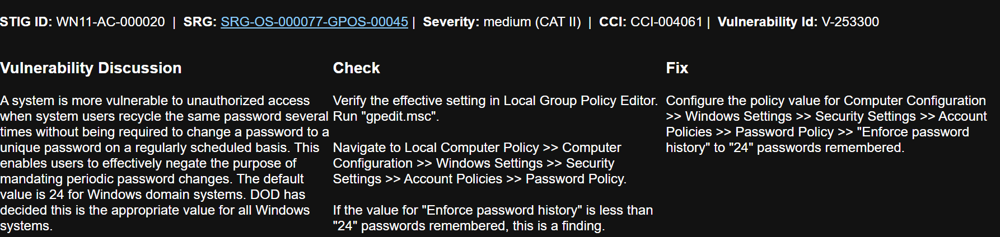
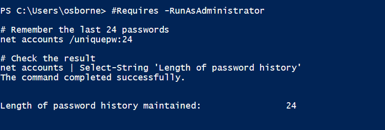

## STIG #9: WN11-AC-000020

**Rule:** The password history must be configured to 24 passwords remembered.

**Severity:** Medium (CAT II)

**What it means:** Windows remembers your last 24 passwords and won’t let you reuse any of them.



### Before

Tenable credentialed scan (DISA STIG audit, Windows 11) → **Failed**


### Manual Remediation

1. Opened Local Computer Policy on the VM
2. Went to `Computer Configuration\Windows Settings\Security Settings\Account Policies\Password Policy`
3. Set "Enforce password history" to 24 passwords remembered
4. Restarted the VM

**After:** rescanned with the same scan → **Passed** ✅


### Undo

Set Enforce password history back to 0 → rescanned → **Failed**


### PowerShell Remediation

Ran `WN11-AC-000020.ps1` as Administrator:

```powershell
#Requires -RunAsAdministrator

# Remember the last 24 passwords
net accounts /uniquepw:24

# Check the result
net accounts | Select-String 'Length of password history'
```



**After:** rescanned with the same scan → **Passed** ✅


### Takeaway

Without history, users cycle between two favorite passwords. Remembering 24 forces genuinely new ones, so an old leaked password can’t come back.
