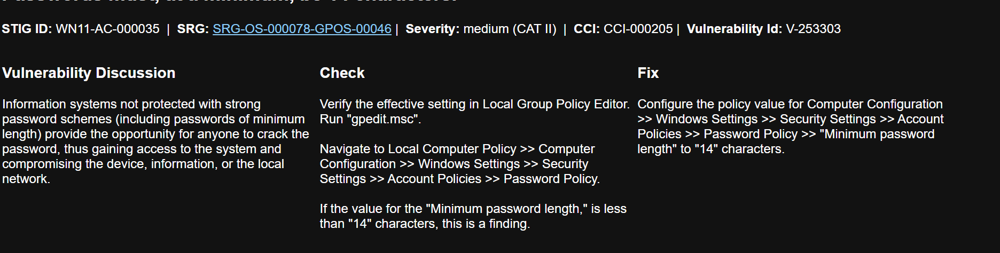
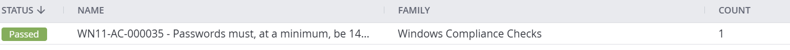
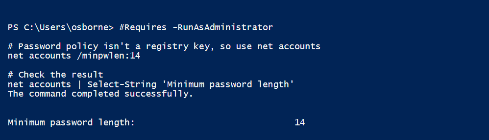
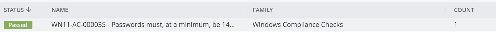

## STIG #8: WN11-AC-000035

**Rule:** Passwords must, at a minimum, be 14 characters.

**Severity:** Medium (CAT II)

**What it means:** Windows will reject any new password shorter than 14 characters.



### Before

Tenable credentialed scan (DISA STIG audit, Windows 11) → **Failed**


### Manual Remediation

1. Opened Local Computer Policy on the VM
2. Went to `Computer Configuration\Windows Settings\Security Settings\Account Policies\Password Policy`
3. Set "Minimum password length" to 14 characters
4. Restarted the VM

**After:** rescanned with the same scan → **Passed** ✅



### Undo

Set Minimum password length back to 0 → rescanned → **Failed**


### PowerShell Remediation

Ran `WN11-AC-000035.ps1` as Administrator:

```powershell
#Requires -RunAsAdministrator

# Password policy isn't a registry key, so use net accounts
net accounts /minpwlen:14

# Check the result
net accounts | Select-String 'Minimum password length'
```



**After:** rescanned with the same scan → **Passed** ✅



### Takeaway

Every extra character makes a password far harder to crack. Length beats complexity.
