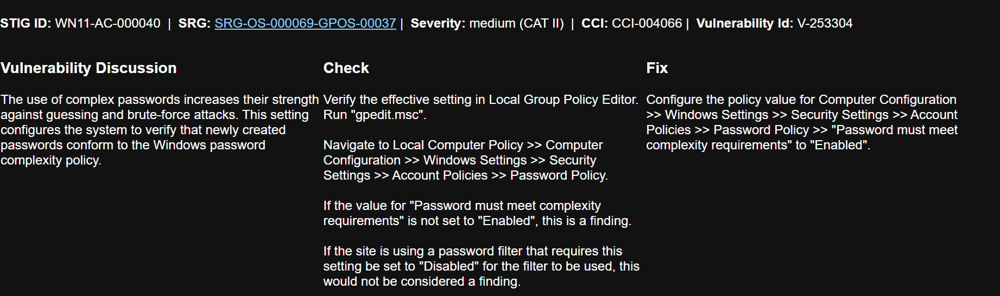
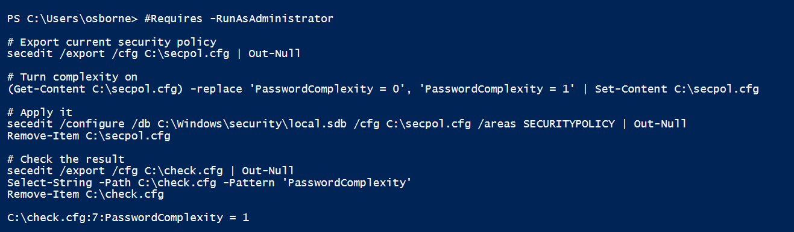

## STIG #10: WN11-AC-000040

**Rule:** The built-in Microsoft password complexity filter must be enabled.

**Severity:** Medium (CAT II)

**What it means:** New passwords have to mix character types, like uppercase, lowercase, numbers and symbols, and can’t contain the username.



### Before

Tenable credentialed scan (DISA STIG audit, Windows 11) → **Failed**


### Manual Remediation

1. Opened Local Computer Policy on the VM
2. Went to `Computer Configuration\Windows Settings\Security Settings\Account Policies\Password Policy`
3. Set "Password must meet complexity requirements" to Enabled
4. Restarted the VM

**After:** rescanned with the same scan → **Passed** ✅


### Undo

Set Password must meet complexity requirements to Disabled → rescanned → **Failed**


### PowerShell Remediation

Ran `WN11-AC-000040.ps1` as Administrator:

```powershell
#Requires -RunAsAdministrator

# Export current security policy
secedit /export /cfg C:\secpol.cfg | Out-Null

# Turn complexity on
(Get-Content C:\secpol.cfg) -replace 'PasswordComplexity = 0', 'PasswordComplexity = 1' | Set-Content C:\secpol.cfg

# Apply it
secedit /configure /db C:\Windows\security\local.sdb /cfg C:\secpol.cfg /areas SECURITYPOLICY | Out-Null
Remove-Item C:\secpol.cfg

# Check the result
secedit /export /cfg C:\check.cfg | Out-Null
Select-String -Path C:\check.cfg -Pattern 'PasswordComplexity'
Remove-Item C:\check.cfg
```



**After:** rescanned with the same scan → **Passed** ✅


### Takeaway

Complexity blocks easy guesses like “password1” or the username. Together with the 14-character minimum, it makes brute-forcing far harder.
