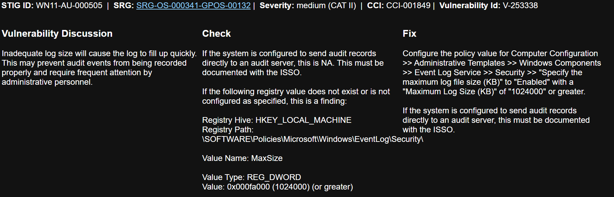
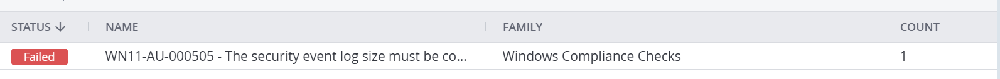
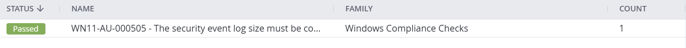
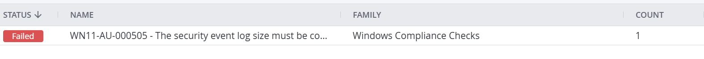
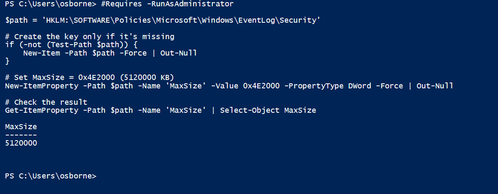

## STIG #2: WN11-AU-000505

**Rule:** The Security event log size must be configured to 1,024,000 KB or greater. (This Tenable audit checks for at least 5,120,000 KB, so I set it to 5,120,000.)

**Severity:** Medium (CAT II)

**What it means:** The Security log records logins, permission changes and account activity. If it’s too small, old entries get overwritten fast, and evidence of an attack can disappear before anyone investigates.



### Before

Tenable credentialed scan (DISA STIG audit, Windows 11) → **Failed**



### Manual Remediation

1. Opened Registry Editor on the VM
2. Went to `HKLM\SOFTWARE\Policies\Microsoft\Windows\EventLog\`
3. Created the key `Security` (it didn’t exist)
4. Created a DWORD value `MaxSize` = `5120000` (decimal)
5. Restarted the VM

**After:** rescanned with the same scan → **Passed** ✅



### Undo

Deleted the `MaxSize` value → rescanned → **Failed**



### PowerShell Remediation

Ran `WN11-AU-000505.ps1` as Administrator:

```powershell
#Requires -RunAsAdministrator

$path = 'HKLM:\SOFTWARE\Policies\Microsoft\Windows\EventLog\Security'

# Create the key only if it's missing
if (-not (Test-Path $path)) {
    New-Item -Path $path -Force | Out-Null
}

# Set MaxSize = 0x4E2000 (5120000 KB)
New-ItemProperty -Path $path -Name 'MaxSize' -Value 0x4E2000 -PropertyType DWord -Force | Out-Null

# Check the result
Get-ItemProperty -Path $path -Name 'MaxSize' | Select-Object MaxSize
```



**After:** rescanned with the same scan → **Passed** ✅


### Takeaway

The Security log is where you look first after an attack. If it’s too small, the evidence is gone before anyone can investigate.
