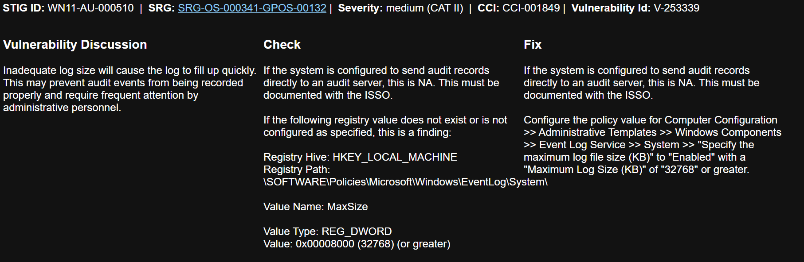
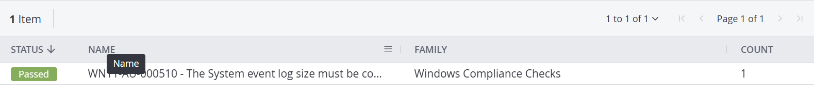
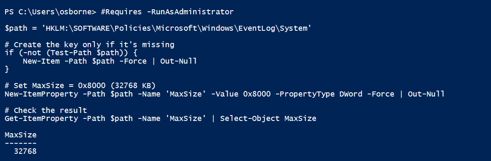

## STIG #3: WN11-AU-000510

**Rule:** The System event log size must be at least 32,768 KB.

**Severity:** Medium (CAT II)

**What it means:** The System log tracks Windows services, drivers and crashes. A bigger log keeps that history around long enough to trace what went wrong.



### Before

Tenable credentialed scan (DISA STIG audit, Windows 11) → **Failed**


### Manual Remediation

1. Opened Registry Editor on the VM
2. Went to `HKLM\SOFTWARE\Policies\Microsoft\Windows\EventLog\`
3. Created the key `System` (it didn’t exist)
4. Created a DWORD value `MaxSize` = `32768` (decimal)
5. Restarted the VM

**After:** rescanned with the same scan → **Passed** ✅



### Undo

Deleted the `MaxSize` value → rescanned → **Failed**


### PowerShell Remediation

Ran `WN11-AU-000510.ps1` as Administrator:

```powershell
#Requires -RunAsAdministrator

$path = 'HKLM:\SOFTWARE\Policies\Microsoft\Windows\EventLog\System'

# Create the key only if it's missing
if (-not (Test-Path $path)) {
    New-Item -Path $path -Force | Out-Null
}

# Set MaxSize = 0x8000 (32768 KB)
New-ItemProperty -Path $path -Name 'MaxSize' -Value 0x8000 -PropertyType DWord -Force | Out-Null

# Check the result
Get-ItemProperty -Path $path -Name 'MaxSize' | Select-Object MaxSize
```



**After:** rescanned with the same scan → **Passed** ✅


### Takeaway

A bigger System log keeps enough history to trace crashes and service changes back to their cause.
