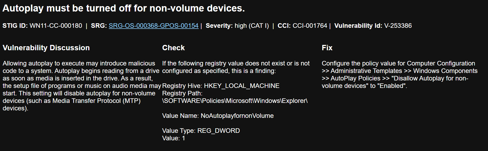
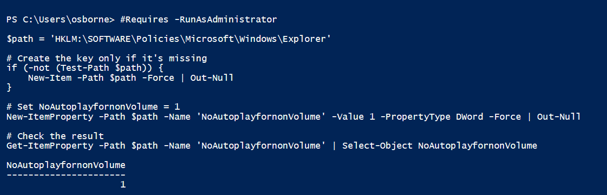

## STIG #4: WN11-CC-000180

**Rule:** Autoplay must be turned off for non-volume devices.

**Severity:** High (CAT I)

**What it means:** Phones, cameras and other plug-in devices can launch content automatically when connected. Turning that off stops malicious code from running the moment a device is plugged in.



### Before

Tenable credentialed scan (DISA STIG audit, Windows 11) → **Failed**


### Manual Remediation

1. Opened Registry Editor on the VM
2. Went to `HKLM\SOFTWARE\Policies\Microsoft\Windows\Explorer`
3. Created a DWORD value `NoAutoplayfornonVolume` = `1` (decimal)
4. Restarted the VM

**After:** rescanned with the same scan → **Passed** ✅


### Undo

Deleted the `NoAutoplayfornonVolume` value → rescanned → **Failed**


### PowerShell Remediation

Ran `WN11-CC-000180.ps1` as Administrator:

```powershell
#Requires -RunAsAdministrator

$path = 'HKLM:\SOFTWARE\Policies\Microsoft\Windows\Explorer'

# Create the key only if it's missing
if (-not (Test-Path $path)) {
    New-Item -Path $path -Force | Out-Null
}

# Set NoAutoplayfornonVolume = 1
New-ItemProperty -Path $path -Name 'NoAutoplayfornonVolume' -Value 1 -PropertyType DWord -Force | Out-Null

# Check the result
Get-ItemProperty -Path $path -Name 'NoAutoplayfornonVolume' | Select-Object NoAutoplayfornonVolume
```



**After:** rescanned with the same scan → **Passed** ✅


### Takeaway

Turning off autoplay means plugging in a device can’t run anything by itself. The user has to choose to open it.
