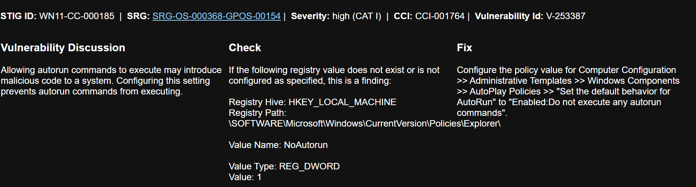
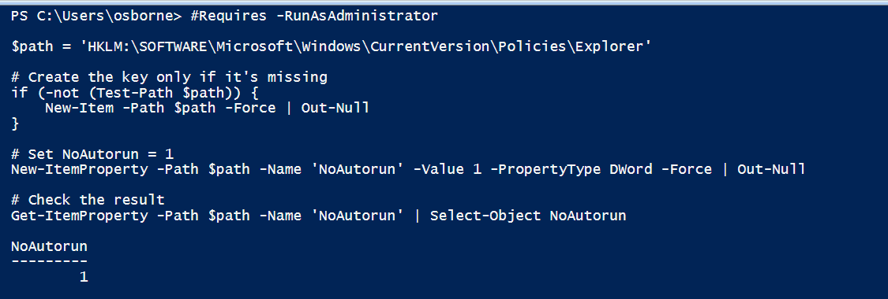

## STIG #5: WN11-CC-000185

**Rule:** The default autorun behavior must be configured to prevent autorun commands.

**Severity:** High (CAT I)

**What it means:** Some discs and USB drives carry an autorun file that tells Windows to launch a program automatically. This setting tells Windows to ignore those commands.



### Before

Tenable credentialed scan (DISA STIG audit, Windows 11) → **Failed**


### Manual Remediation

1. Opened Registry Editor on the VM
2. Went to `HKLM\SOFTWARE\Microsoft\Windows\CurrentVersion\Policies\Explorer`
3. Created a DWORD value `NoAutorun` = `1` (decimal)
4. Restarted the VM

**After:** rescanned with the same scan → **Passed** ✅


### Undo

Deleted the `NoAutorun` value → rescanned → **Failed**


### PowerShell Remediation

Ran `WN11-CC-000185.ps1` as Administrator:

```powershell
#Requires -RunAsAdministrator

$path = 'HKLM:\SOFTWARE\Microsoft\Windows\CurrentVersion\Policies\Explorer'

# Create the key only if it's missing
if (-not (Test-Path $path)) {
    New-Item -Path $path -Force | Out-Null
}

# Set NoAutorun = 1
New-ItemProperty -Path $path -Name 'NoAutorun' -Value 1 -PropertyType DWord -Force | Out-Null

# Check the result
Get-ItemProperty -Path $path -Name 'NoAutorun' | Select-Object NoAutorun
```



**After:** rescanned with the same scan → **Passed** ✅


### Takeaway

Malware loves autorun because it runs without a click. Blocking it puts the decision back with the user.
