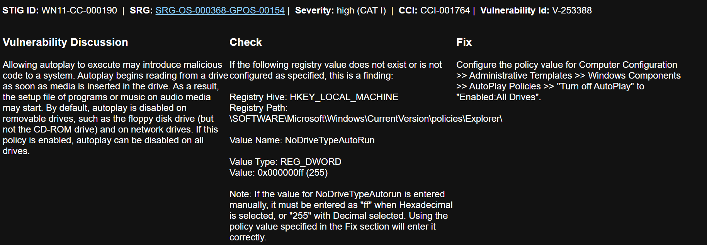
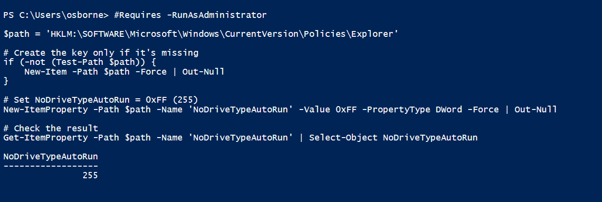

## STIG #6: WN11-CC-000190

**Rule:** Autoplay must be disabled for all drives.

**Severity:** High (CAT I)

**What it means:** By default, Windows still autoplays some drive types, like CD/DVD. This turns autoplay off for every drive type, so nothing starts on its own when media is inserted.



### Before

Tenable credentialed scan (DISA STIG audit, Windows 11) → **Failed**


### Manual Remediation

1. Opened Registry Editor on the VM
2. Went to `HKLM\SOFTWARE\Microsoft\Windows\CurrentVersion\policies\Explorer`
3. Created a DWORD value `NoDriveTypeAutoRun` = `255` (decimal)
4. Restarted the VM

**After:** rescanned with the same scan → **Passed** ✅


### Undo

Deleted the `NoDriveTypeAutoRun` value → rescanned → **Failed**


### PowerShell Remediation

Ran `WN11-CC-000190.ps1` as Administrator:

```powershell
#Requires -RunAsAdministrator

$path = 'HKLM:\SOFTWARE\Microsoft\Windows\CurrentVersion\Policies\Explorer'

# Create the key only if it's missing
if (-not (Test-Path $path)) {
    New-Item -Path $path -Force | Out-Null
}

# Set NoDriveTypeAutoRun = 0xFF (255)
New-ItemProperty -Path $path -Name 'NoDriveTypeAutoRun' -Value 0xFF -PropertyType DWord -Force | Out-Null

# Check the result
Get-ItemProperty -Path $path -Name 'NoDriveTypeAutoRun' | Select-Object NoDriveTypeAutoRun
```



**After:** rescanned with the same scan → **Passed** ✅


### Takeaway

One setting closes the gap for every drive type at once. That’s defense in depth alongside #4 and #5.
