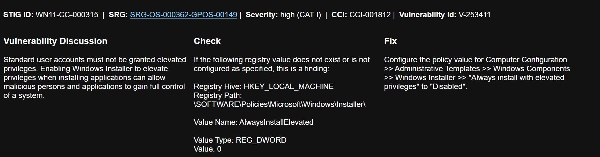
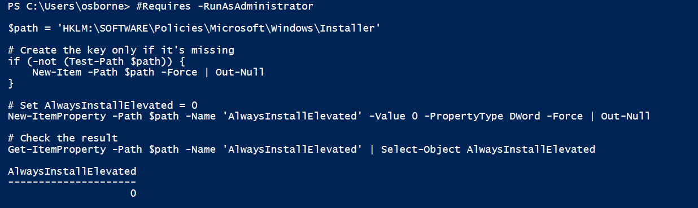

## STIG #7: WN11-CC-000315

**Rule:** The Windows Installer feature “Always install with elevated privileges” must be disabled.

**Severity:** High (CAT I)

**What it means:** If this is on, any user, even a standard one, can install software with full admin rights. Attackers use it to turn a normal account into an admin.



### Before

Tenable credentialed scan (DISA STIG audit, Windows 11) → **Failed**


### Manual Remediation

1. Opened Registry Editor on the VM
2. Went to `HKLM\SOFTWARE\Policies\Microsoft\Windows\Installer`
3. Created a DWORD value `AlwaysInstallElevated` = `0` (decimal)
4. Restarted the VM

**After:** rescanned with the same scan → **Passed** ✅


### Undo

Deleted the `AlwaysInstallElevated` value → rescanned → **Failed**


### PowerShell Remediation

Ran `WN11-CC-000315.ps1` as Administrator:

```powershell
#Requires -RunAsAdministrator

$path = 'HKLM:\SOFTWARE\Policies\Microsoft\Windows\Installer'

# Create the key only if it's missing
if (-not (Test-Path $path)) {
    New-Item -Path $path -Force | Out-Null
}

# Set AlwaysInstallElevated = 0
New-ItemProperty -Path $path -Name 'AlwaysInstallElevated' -Value 0 -PropertyType DWord -Force | Out-Null

# Check the result
Get-ItemProperty -Path $path -Name 'AlwaysInstallElevated' | Select-Object AlwaysInstallElevated
```



**After:** rescanned with the same scan → **Passed** ✅


### Takeaway

This is a classic privilege escalation path. Keeping it off means a standard user stays a standard user.
